# 🚦 DriveGuard AI — Real-Time Traffic Violation Detection & Intelligence System

[](https://github.com/narendrakalam2001/driveguard-ai/actions)
[](https://python.org)
[](https://pytorch.org)
[](https://github.com/ultralytics/ultralytics)
[](https://fastapi.tiangolo.com)
[](https://driveguard-ai-lite.streamlit.app)
[](#-test-coverage)
[](https://docker.com)
[](https://huggingface.co/narendrakalam2001/driveguard-ai-models)
[](LICENSE)

> **Domain:** Computer Vision / Smart Cities / Road Safety  
> **Problem:** Detect vehicles in traffic video, measure each vehicle's speed, flag speed violations, read the number plate and draft an evidence-backed notice under the Motor Vehicles Act  
> **Datasets:** [UA-DETRAC](https://www.kaggle.com/datasets/dtrnngc/ua-detrac-dataset) (vehicle detection) · [Indian number plates](https://www.kaggle.com/datasets/dataclusterlabs/indian-number-plates) (ANPR) · Motor Vehicles Act knowledge base (RAG)  
> **Industry Context (target users):** NHAI · state traffic police · Smart City SPVs · Tata Projects · L&T Smart City · Accenture Smart City practice

<p align="center">
  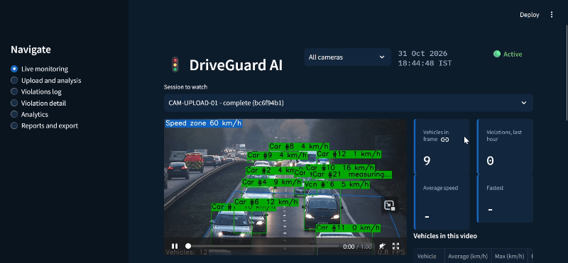
</p>

---

## 💡 Why This Project Matters

According to the Ministry of Road Transport & Highways (*Road Accidents in India 2023*), India recorded about **4.80 lakh road accidents and 1.72 lakh deaths** in 2023 — roughly **20 deaths every hour**. **Over-speeding accounted for 68.1% of those deaths**, and two-wheeler riders for 44.8%. Enforcement still depends largely on people watching CCTV or on fixed speed guns, so most violations are never recorded.

DriveGuard AI is a production-shaped prototype of the missing piece — a system that watches the road continuously, measures speed, identifies the vehicle and prepares an evidence pack for a human officer to review:

- A **YOLOv8m detector** finds vehicles (Car, Truck, Bus, Van, Motorcycle, Auto-rickshaw, Bicycle) and **DeepSORT** gives each one a persistent ID across frames
- The operator **clicks 4 corners of a road stretch** and enters its real width and length — a **homography** converts pixels to metres, and speed is computed from **real video time** (not wall-clock time)
- A **physical glitch filter** (acceleration limit · minimum readings · median decision · plausibility cap) stops tracker errors from becoming false violations
- **Severity bands** (WARNING > 1.1× · VIOLATION > 1.2× · SEVERE > 1.5× the limit) are applied on top of the speed — and **one vehicle is one violation record**, upgraded in place as it gets worse
- An **ANPR module** (plate detector + EasyOCR + format validation) reads the plate; every accepted plate keeps its crop so wrong readings can be caught by eye
- A **RAG + Gemini notice generator** drafts the notice, **validates it** against the facts it was given, and falls back to a deterministic template — enforcement never blocks on an LLM outage
- A **6-screen Streamlit control room** shows live detection, the processed video, evidence, analytics and exports

Every claim in this README is either measured or explicitly marked as an estimate or a limitation.

---

## 🏆 Prototype Results

| Metric | Result |
|---|---|
| **Vehicle detector** | `YOLOv8m — mAP@0.5 = 0.680 · mAP@0.5:0.95 = 0.508` |
| **Precision / Recall** | `0.707 / 0.652` |
| **Best classes (mAP@0.5)** | `Car = 0.806 · Bus = 0.797` |
| **Weakest classes (mAP@0.5)** | `Van = 0.568 · Truck = 0.550` |
| **Training** | `30 epochs · 8,380 train / 5,634 val images · ~2.3 h on a Kaggle T4` |
| **Plate detector** | `YOLOv8n — mAP@0.5 = 0.680 (47 hold-out images, 52 plates) — proof of concept` |
| **Plate OCR (36 hand-labelled crops)** | `27.8% exact match · 73.2% character accuracy · 52.8% valid format` |
| **Pipeline speed (CPU)** | `≈ 1.7 FPS — 720×1280 video, every frame, plates on (Intel i7-10510U laptop, one run)` |
| **Knowledge base** | `23 documents in ChromaDB (8 MV Act sections · 7 fine entries · 5 speed-limit entries · 3 FAQ chunks)` |
| **API / Dashboard** | `31 FastAPI routes · 6 Streamlit screens` |
| **Automated tests** | `364 passing` |
| **Original targets** | `mAP@0.5 > 0.85 — not met · 25 FPS on GPU — not measured · speed error ±3 km/h — not validated` |

> The numbers above are what the system actually achieved. The three original targets are listed so the gap is visible, not hidden. See the **Ethical Considerations & Limitations** section below.

---

## 🔗 Live Links

| Service | URL |
|---|---|
| 📊 **Traffic Control Dashboard (Lite Demo)** | [https://driveguard-ai-lite.streamlit.app](https://driveguard-ai-lite.streamlit.app) |
| 🚀 **FastAPI (Swagger UI)** | Full AI pipeline, runs locally at `http://localhost:8000/docs` |
| 🤗 **Model weights (HuggingFace Hub, public)** | [narendrakalam2001/driveguard-ai-models](https://huggingface.co/narendrakalam2001/driveguard-ai-models) — no login or token needed to download |
| 📓 **EDA Notebook** | [notebooks/driveguard_ai_eda.ipynb](notebooks/driveguard_ai_eda.ipynb) |
| 📓 **Kaggle Training Notebook** | [notebooks/Kaggle_Training.ipynb](notebooks/Kaggle_Training.ipynb) |

> ℹ️ **About the live demo:** the hosted dashboard is a **lite version** that runs on Streamlit Community Cloud
> without the AI backend. It uses **synthetic data** (1,800 violations, 8 cameras, 6 months; no real vehicles or
> people) so you can explore the violations log, notices, analytics, exports and PDF reports.
> **Video upload and live detection (YOLOv8 + DeepSORT + ANPR) are not available in the hosted demo** because
> the free tier has too little memory for the models. To process real videos, run the full stack locally
> (see [Quickstart](#-quickstart)); the model weights download automatically from the public Hub repo.
> More details: [Hosted Lite Demo](#hosted-lite-demo).

---

## 🏗️ System Architecture

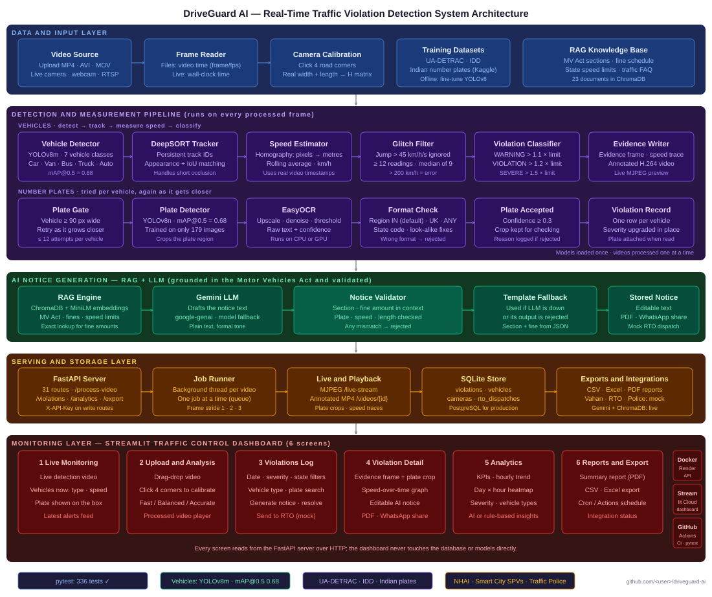

```
╔════════════════════════════════════════════════════════════════════════════════════════════╗
║    DRIVEGUARD AI — 5-LAYER REAL-TIME TRAFFIC ENFORCEMENT SYSTEM                            ║
╠════════════════════════════════════════════════════════════════════════════════════════════╣
║                                                                                            ║
║ ┌─ DATA & INPUT LAYER ───────────────────────────────────────────────────────────────────┐ ║
║ │ Video file (MP4/AVI/MOV) or live camera → VideoStream (timestamps = frame ÷ fps)       │ ║
║ │ Click 4 road corners + real width/length → homography (pixels → metres)                │ ║
║ │ Training: UA-DETRAC · IDD · Indian plates   |   RAG corpus: MV Act · fines · limits    │ ║
║ └────────────────────────────────────────────────────────────────────────────────────────┘ ║
║                                             ▼                                              ║
║ ┌─ DETECTION & MEASUREMENT PIPELINE (every processed frame) ─────────────────────────────┐ ║
║ │ YOLOv8m (7 classes) → DeepSORT track IDs → speed (homography, real video time)         │ ║
║ │ Glitch filter: accel ≤ 45 km/h/s · ≥ 12 readings · median of 9 · ≥ 200 = error         │ ║
║ │ Severity: WARNING > 1.1x · VIOLATION > 1.2x · SEVERE > 1.5x limit (1 row/vehicle)      │ ║
║ │ ANPR: vehicle ≥ 90 px → YOLOv8n plate box → EasyOCR → format check (IN/UK/ANY)         │ ║
║ │ Outputs: evidence frame · plate crop · speed trace · annotated H.264 video             │ ║
║ └────────────────────────────────────────────────────────────────────────────────────────┘ ║
║                                             ▼                                              ║
║ ┌─ AI NOTICE GENERATION — RAG + LLM ─────────────────────────────────────────────────────┐ ║
║ │ ChromaDB RAG + exact fine/section lookup → Gemini (model fallback chain)               │ ║
║ │ Validator: section · fine amount · plate · speed  →  reject → template fallback        │ ║
║ └────────────────────────────────────────────────────────────────────────────────────────┘ ║
║                                             ▼                                              ║
║ ┌─ SERVING & STORAGE LAYER ──────────────────────────────────────────────────────────────┐ ║
║ │ FastAPI (31 routes) · job queue (1 video at a time) · MJPEG live stream                │ ║
║ │ SQLite: violations · vehicles · cameras · rto_dispatches                               │ ║
║ │ Exports: CSV · Excel · PDF notice · PDF summary report                                 │ ║
║ └────────────────────────────────────────────────────────────────────────────────────────┘ ║
║                                             ▼                                              ║
║ ┌─ MONITORING LAYER — STREAMLIT TRAFFIC CONTROL DASHBOARD ───────────────────────────────┐ ║
║ │ 1 Live Monitoring · 2 Upload & Analysis · 3 Violations Log                             │ ║
║ │ 4 Violation Detail · 5 Analytics · 6 Reports & Export                                  │ ║
║ │ Mock integrations (labelled in the UI): Vahan · RTO portal · Police dashboard          │ ║
║ └────────────────────────────────────────────────────────────────────────────────────────┘ ║
║                                                                                            ║
╚════════════════════════════════════════════════════════════════════════════════════════════╝
```

> **Two run modes, one dashboard.** With `DRIVEGUARD_API_URL` set, the dashboard talks to the FastAPI backend above (full pipeline).
> Without it (the hosted demo), a built-in `DemoClient` answers the same requests from a bundled synthetic database, so the
> dashboard runs on a free host without the AI models.

---

## 📸 Dashboard Screenshots

### 📤 Step 1 — Upload & Analysis

Drag-and-drop a traffic video (MP4 / AVI / MOV, up to 500 MB). The wizard walks through four steps: upload → mark the road → lane and speed limit → confirm and run.


---

### 🎯 Step 2 — Mark the Road

Click the 4 corners of a road stretch directly on the video frame (top-left → top-right → bottom-right → bottom-left). The selected corner is highlighted and the next one is chosen automatically; number boxes remain for fine adjustment.

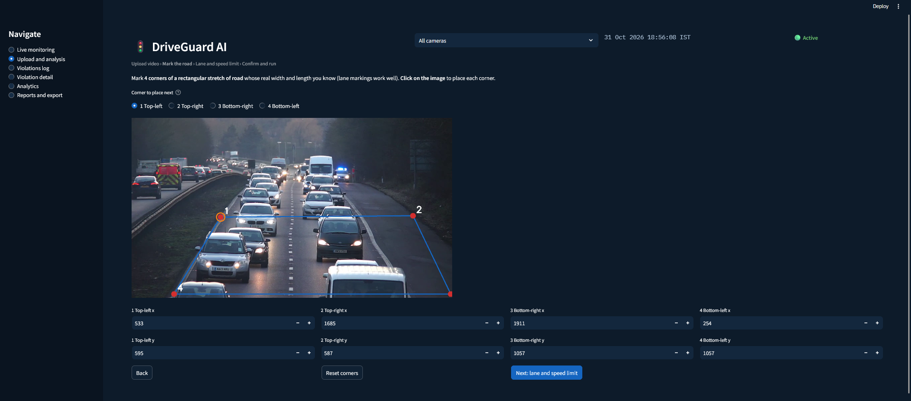

---

### 📏 Step 3 — Lane & Speed Limit

Real width **and length** of the marked stretch (speed scales with the length), zone type (School 25 · Residential 40 · City Road 60 · Highway 100 km/h), plate reading on/off, and processing mode (every frame / every 2nd / every 3rd).


---

### ✅ Step 4 — Confirm & Run

Review the settings, then process. Detection plays live while the job runs; a progress bar shows the real share of frames processed.


---

### 📊 Processing Complete — Summary

Total vehicles, violations, average and maximum speed, and number-plate statistics (plates read, attempts, rejections and why).

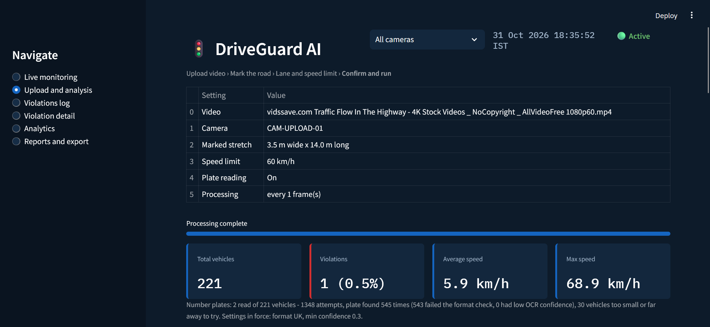

---

### 🎬 Processed Video

The whole video replays with boxes, vehicle type, speed and plate drawn on every frame (H.264, plays in any browser) — with a download button.

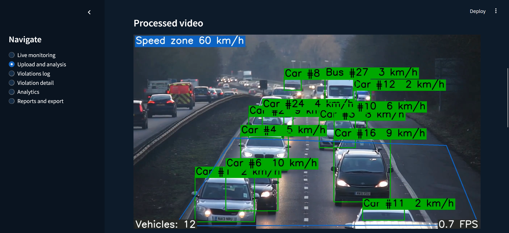

---

### 🚗 Vehicles in This Video

Every tracked vehicle: type, average and maximum speed, plate, and violation count.

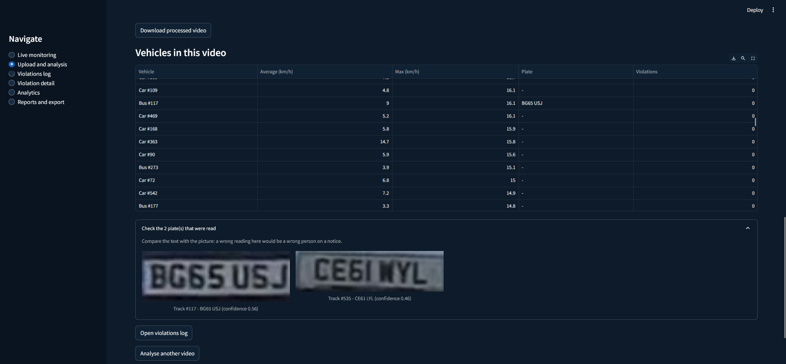

---

### 📡 Live Monitoring

Detection plays as live video (MJPEG stream) with a table of the vehicles in frame — type, ID, speed, plate — plus KPI cards and the latest alerts.

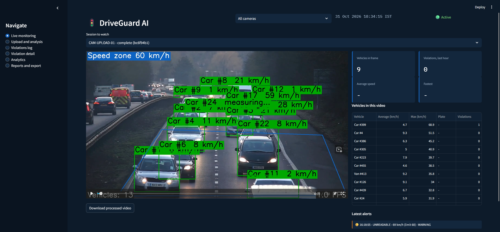

---

### 🚨 Violations Log

Filter by date range, severity, status, vehicle type, state code and plate. Select a row to view evidence, generate a notice, mark it resolved, or send it to the RTO (mock). Export the filtered set to CSV or Excel.

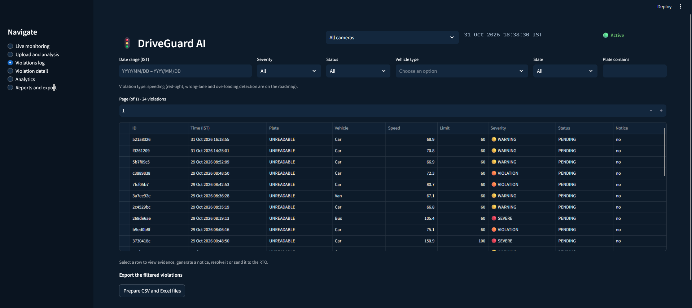

---

### 🔎 Violation Detail

Evidence frame at the moment of violation, zoomed plate crop, vehicle facts (type, plate, state) and violation facts (speed, limit, excess, severity, camera, time, status).

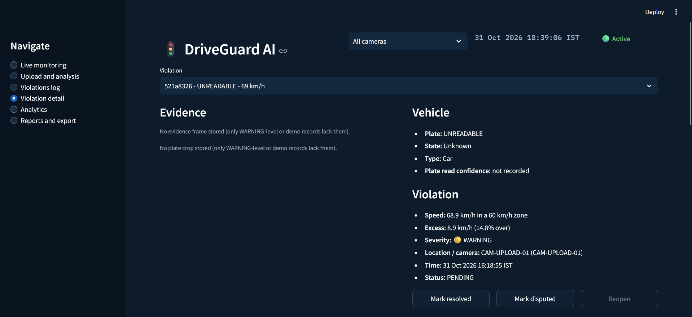

---

### 📈 Speed Over Time & AI Notice

The vehicle's speed against the limit and the +20% / +50% bands, and the **editable AI-drafted notice** with PDF download, WhatsApp share and a mock RTO dispatch.


---

### 📊 Analytics — KPIs & Trends

Violations today / this month, insights (AI-written or rule-based), hourly trend, severity split, vehicle types and speed distribution.

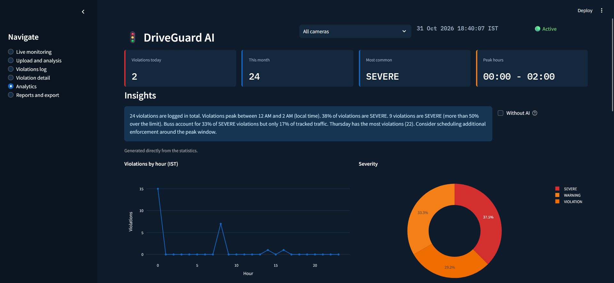

---

### 🗓️ Analytics — Heatmap, Monthly Trend, States

Day × hour heatmap, monthly trend, breakdown by plate state code and top offending plates.

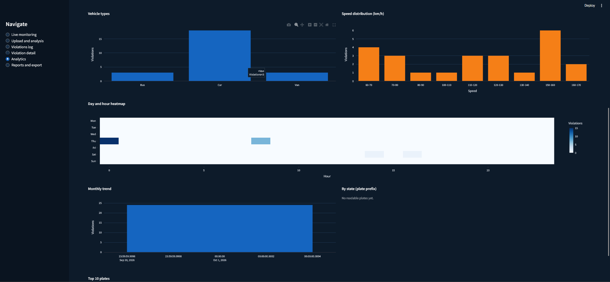

---

### 📦 Reports & Export

A one-click supervisor summary report (PDF) and filtered CSV / Excel export.

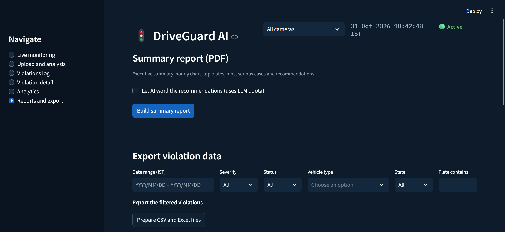

---

### 🗓️ Scheduled Reports & Integration Status

A cron / GitHub Actions recipe for scheduled reports, and an honest integration panel: Gemini and ChromaDB are live; Vahan, the RTO portal and the police dashboard are **mocks** and labelled as such.

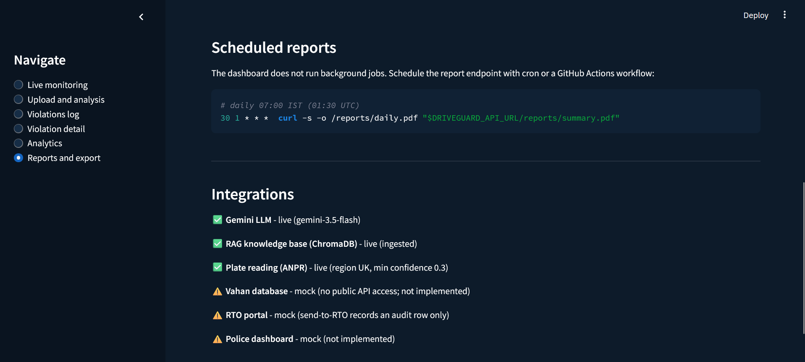

---

## 📊 Training Reports

| Training Curves | Normalized Confusion Matrix |
|---|---|
| 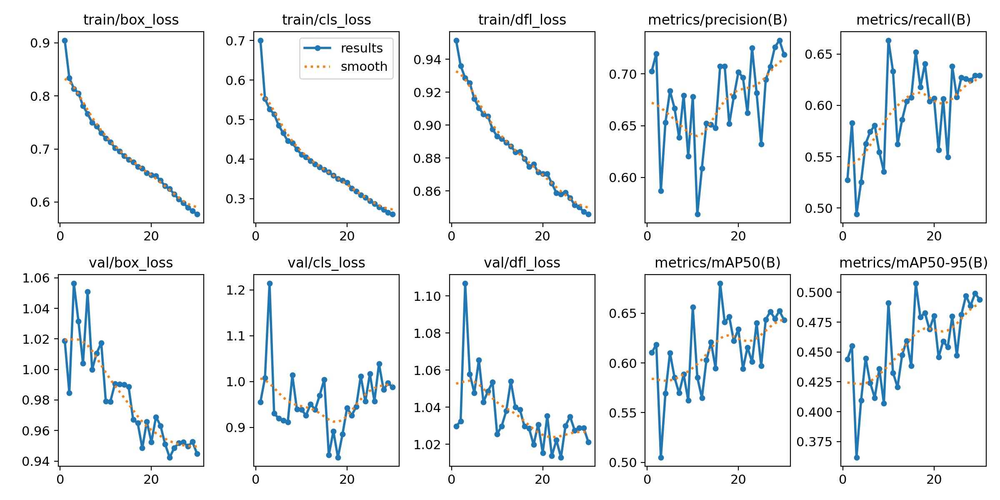 | 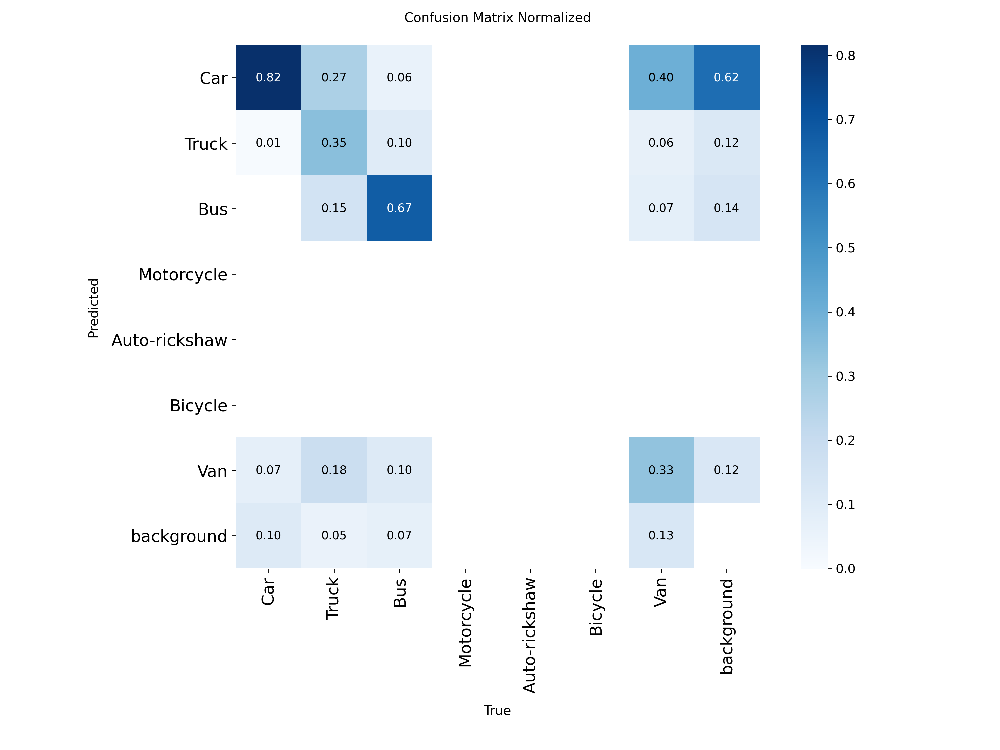 |

| Precision–Recall Curve | Validation Predictions |
|---|---|
| 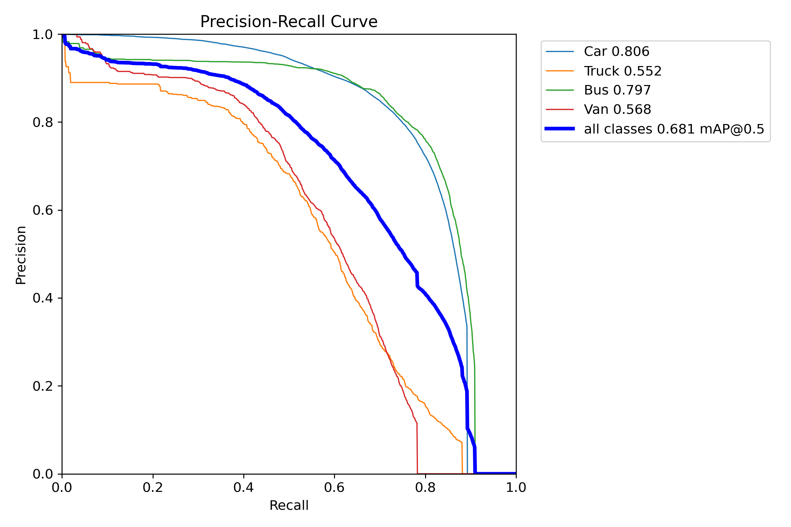 | 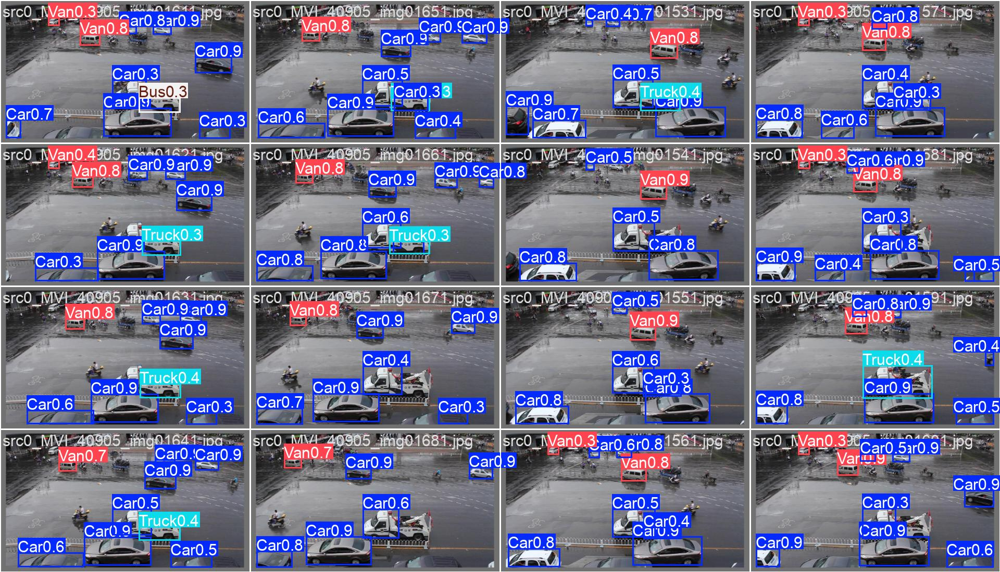 |

Raw per-epoch metrics: [`docs/plots/results.csv`](docs/plots/results.csv) · Training notebook: [`notebooks/Kaggle_Training.ipynb`](notebooks/Kaggle_Training.ipynb)

---

## 🎬 System Demo


---

## 📁 Project Structure

```
driveguard-ai/
│
├── src/                                    # Core pipeline
│   ├── config.py                           # All thresholds, speed zones, env-driven settings
│   ├── data_loader.py                      # VideoStream (video-time timestamps) · dataset loading
│   ├── preprocessing.py                    # Letterbox · normalize · augmentation
│   ├── vehicle_detector.py                 # YOLOv8m detector wrapper (7 classes)
│   ├── tracker.py                          # DeepSORT tracker wrapper
│   ├── camera_calibrator.py                # 4-point homography · pixels → metres
│   ├── speed_estimator.py                  # Windowed speed · warm-up · clamping
│   ├── violation_classifier.py             # WARNING / VIOLATION / SEVERE bands
│   ├── plate_recognizer.py                 # Plate detector + EasyOCR
│   ├── plate_text.py                       # Normalize · position-aware fixes · IN / UK / ANY formats
│   ├── alert_system.py                     # SQLite persistence · filters · analytics · live feed
│   ├── rag_engine.py                       # ChromaDB retrieval + exact fine / section lookup
│   ├── report_generator.py                 # Notice generation · validator · template fallback
│   ├── llm_client.py                       # Gemini client with model fallback chain
│   ├── insights.py                         # AI or rule-based analytics insights
│   ├── report_export.py                    # CSV · Excel · PDF notice · PDF summary
│   ├── video_writer.py                     # Browser-playable H.264 annotated video
│   └── synthetic_data_gen.py               # Faker-based synthetic violations
│
├── services/
│   └── detection_service.py                # detect → track → speed → filter → classify → plate → log
│
├── serving/
│   └── api.py                              # FastAPI — 31 routes
│
├── frontend/
│   ├── app.py                              # 6-screen Streamlit dashboard (full mode + lite demo mode)
│   ├── api_client.py                       # HTTP client with clear error messages
│   ├── demo_client.py                      # Lite-demo backend: serves the same endpoints from bundled synthetic data
│   ├── helpers.py                          # Plate formatting · calibration drawing · click scaling
│   ├── states.py                           # Plate state-code → state name
│   └── requirements.txt                    # Light dependencies for the hosted dashboard (no torch)
│
├── scripts/
│   ├── run_api.py · run_dashboard.py       # Start the API / dashboard
│   ├── ingest_knowledge_base.py            # Build the ChromaDB RAG store
│   ├── calibrate_camera.py                 # Command-line calibration (--lane-width --lane-depth)
│   ├── plate_check.py                      # Test the plate pipeline on one image / frame
│   ├── train_detector.py                   # YOLOv8m training entry point
│   ├── train_plate_detector.py             # YOLOv8n plate detector training
│   ├── prepare_plate_dataset.py            # Plate dataset preparation
│   ├── make_subset.py · find_duplicate_images.py · inspect_plate_dataset.py
│   ├── preview_yolo_labels.py · try_plate_detector.py
│   ├── ocr_bench.py · evaluate_plate_ocr.py  # OCR benchmarks on hand-labelled crops
│   ├── seed_demo_data.py                   # Synthetic violations for local demos
│   ├── build_demo_db.py                    # Rebuild the bundled lite-demo database (1,800 synthetic violations)
│   ├── frames_to_video.py                  # Build a demo clip from dataset frames
│   ├── download_models.py                  # Fetch weights from the (public) HuggingFace Hub repo
│   ├── push_models_to_hf.py                # Upload weights to the HuggingFace Hub
│   └── check_rag.py                        # Verify RAG retrieval
│
├── notebooks/
│   ├── driveguard_ai_eda.ipynb             # Exploratory data analysis
│   └── Kaggle_Training.ipynb               # YOLOv8m training on a Kaggle T4
│
├── data/
│   ├── demo/
│   │   └── demo_violations.db              # Bundled SYNTHETIC data for the hosted lite demo
│   └── knowledge_base/
│       ├── mv_act_sections.json            # Motor Vehicles Act sections (RAG)
│       ├── fine_schedule.json              # Indicative fine amounts
│       ├── speed_limits.json               # Speed-limit rules
│       └── traffic_faq.md                  # FAQ chunks
│
├── models/
│   ├── model_card.json                     # Vehicle detector model card
│   └── plate_model_card.json               # Plate detector model card
│                                           # (weights: yolov8_vehicle.pt · yolov8_plate.pt → public HuggingFace Hub repo)
│
├── violation_logs/
│   └── schema.sql                          # SQLite schema: cameras · vehicles · violations · rto_dispatches
│
├── tests/                                  # 364 pytest tests (29 modules)
│
├── docs/
│   ├── architecture/
│   │   └── system_architecture.svg         # 5-layer architecture diagram
│   ├── gifs/
│   │   └── User_Portal.gif                 # Dashboard demo
│   ├── plots/
│   │   ├── results.png · results.csv       # Training curves + raw metrics
│   │   ├── confusion_matrix_normalized.png # Normalized confusion matrix
│   │   ├── BoxPR_curve.png                 # Precision–recall curve
│   │   └── val_batch0_pred.jpg             # Validation predictions
│   └── screenshots/                        # 15 dashboard screens used in this README
│
├── .streamlit/config.toml                  # Dark control-room theme
├── Dockerfile                              # FastAPI production image (CPU)
├── Dockerfile.dashboard                    # Dashboard-only image
├── docker-compose.yml                      # API + dashboard (ports 8000 + 8501)
├── render.yaml                             # Render.com blueprint for the full API (needs ≥ 2 GB RAM; not the free tier)
├── .github/workflows/ci.yml                # Lint · tests · Docker builds · model-size check
├── .gitignore · .dockerignore
├── .env.example                            # All settings, documented
├── requirements.txt
├── LICENSE                                 # MIT
└── README.md                               # This file
```

---

## 🚀 Quickstart

### 1. Clone & Install

```bash
git clone https://github.com/narendrakalam2001/driveguard-ai.git
cd driveguard-ai

conda create -n driveguard python=3.11 -y && conda activate driveguard   # or: python -m venv .venv
pip install -r requirements.txt

cp .env.example .env      # Windows: copy .env.example .env  → then add your GEMINI_API_KEY
```

### 2. Get the Model Weights

The trained weights are hosted in a **public** HuggingFace repo, so no account or token is required:

```bash
# macOS / Linux
HF_MODEL_REPO=narendrakalam2001/driveguard-ai-models python scripts/download_models.py

# Windows PowerShell
$env:HF_MODEL_REPO="narendrakalam2001/driveguard-ai-models"; python scripts/download_models.py
```

This places `yolov8_vehicle.pt` and `yolov8_plate.pt` in `models/`. (You can also train them yourself — see the notebooks.)

### 3. Build the RAG Knowledge Base

```bash
python scripts/ingest_knowledge_base.py
```

Expected output (abridged):
```
INFO  Parsed 8 MV Act sections · 7 fine schedule entries · 5 speed limit entries
INFO  Chunked traffic_faq.md into 3 pieces
INFO  Ingested 23 documents into collection 'mv_act_knowledge_base'
```

### 4. Start the API

```bash
python scripts/run_api.py
# API:  http://localhost:8000
# Docs: http://localhost:8000/docs
```

Expected output (abridged) — wait for the last line before uploading a video:
```
INFO  VehicleDetector loaded weights=models/yolov8_vehicle.pt finetuned=True
INFO  PlateRecognizer loaded detector=models/yolov8_plate.pt
INFO  Models preloaded; plate reading: region=IN min_confidence=0.3 ...
INFO  Uvicorn running on http://0.0.0.0:8000
```

### 5. Start the Dashboard

```bash
python scripts/run_dashboard.py
# Dashboard: http://localhost:8501
```

Open **Upload and analysis**, upload a video, click the 4 road corners, enter the real width and length, and press **Confirm and process video**.

### 6. (Optional) Demo Data Without a Video

```bash
python scripts/seed_demo_data.py --count 1000      # synthetic violations for the dashboard (needs the API running)
```

To try the dashboard **without the API and without any models** (the same mode as the hosted demo):

```bash
pip install -r frontend/requirements.txt
DRIVEGUARD_DEMO=1 streamlit run frontend/app.py                 # macOS / Linux
$env:DRIVEGUARD_DEMO="1"; streamlit run frontend/app.py          # Windows PowerShell
```

### 7. Run Tests

```bash
python -m pytest tests -q --cov=src --cov=services --cov=serving
# 364 collected · 364 passed
```

---

## 🐳 Docker

```bash
# Start everything
docker compose up --build

# API only
docker compose up api

# Dashboard only
docker compose up dashboard

# Stop
docker compose down
```

| Service | URL |
|---|---|
| FastAPI + Swagger | `http://localhost:8000/docs` |
| Streamlit Dashboard | `http://localhost:8501` |

---

<a id="hosted-lite-demo"></a>

## ☁️ Hosted Lite Demo (Streamlit Cloud)

The public demo runs **without the AI backend**. Streamlit Community Cloud has about 1 GB of RAM, far too little for YOLOv8m + EasyOCR + sentence-transformers, so the hosted dashboard uses a built-in `DemoClient` (`frontend/demo_client.py`) instead of the FastAPI server.

| | Hosted lite demo | Full system (local / Docker) |
|---|---|---|
| Data | 1,800 **synthetic** violations · 8 cameras · 6 months (`data/demo/demo_violations.db`) | Real detections from your videos |
| Violations log · detail · status · notices · exports · PDF reports | ✅ | ✅ |
| Analytics and insights | ✅ (rule-based; AI-written if a Gemini key is set) | ✅ |
| AI-drafted notices | Fixed template; Gemini if a key is set (capped per app run) | Gemini + RAG + validator |
| Video upload, live detection, tracking, speed, plates | ❌ (recorded screenshots shown instead) | ✅ |
| Evidence images and speed traces | ❌ (not part of the synthetic data) | ✅ |

**How it is deployed:** Streamlit Community Cloud → repository `driveguard-ai`, branch `main`, main file `frontend/app.py`, Python 3.11. It installs `frontend/requirements.txt` (no torch). Demo mode switches on automatically when `DRIVEGUARD_API_URL` is not set.

**Optional AI notices in the demo:** add the key in the app's **Settings → Secrets**:

```toml
GEMINI_API_KEY = "your_key"
```

The demo then drafts notices with Gemini (still grounded by the exact fine/section lookup and the notice validator, with a fallback to the template). Calls are capped per app run (`DRIVEGUARD_DEMO_LLM_LIMIT`, default 60) so a public demo cannot use up the whole quota.

**Rebuild the demo data:** `python scripts/build_demo_db.py --count 1800 --seed 42` (deterministic; all plates and incidents are randomly generated, no real vehicle or person is represented). Changes made in the hosted demo are shared by its visitors and are discarded when the app restarts.

---

## 🌐 API Reference

Interactive docs at `/docs`. If `DRIVEGUARD_API_KEY` is set, all state-changing endpoints require the header `X-API-Key`.

### POST /process-video — Analyse an Uploaded Video

```bash
curl -X POST "http://localhost:8000/process-video" \
  -F "file=@sample_videos/junction.mp4" \
  -F "camera_id=CAM-JN-01" \
  -F "speed_limit_kmph=60" \
  -F "lane_width_m=3.5" \
  -F "lane_depth_m=14" \
  -F "frame_stride=3" \
  -F 'calibration_points=[{"x":243,"y":198},{"x":397,"y":198},{"x":499,"y":324},{"x":141,"y":324}]'
```

**Response** (processing runs in the background):
```json
{
  "session_id": "b95a796c-2b24-46a1-97d1-87f51b567fee",
  "status": "QUEUED",
  "detail": null,
  "summary": null,
  "progress": null,
  "video_ready": false,
  "video_playable": true
}
```

### GET /process-status/{session_id}

Poll until `status` is `COMPLETE` (or `FAILED`). The summary below uses **illustrative values** to show the shape:

```json
{
  "session_id": "b95a796c-...",
  "status": "COMPLETE",
  "progress": 1.0,
  "video_ready": true,
  "summary": {
    "total_frames": 370,
    "total_vehicles": 55,
    "total_violations": 4,
    "average_speed_kmph": 41.2,
    "max_speed_kmph": 78.5,
    "max_speed_plate": "MH12AB1234",
    "plates_read": 2,
    "plate_attempts": 140,
    "plate_boxes_found": 60,
    "vehicles_too_small_for_plate": 31,
    "plates_rejected_format": 40,
    "plates_rejected_confidence": 18,
    "plate_region": "IN",
    "plate_min_confidence": 0.3
  }
}
```

### GET /violations — Filtered, Paged Violation Log

```bash
curl "http://localhost:8000/violations?severity=SEVERE&state_code=MH&date_from=2026-11-01&limit=50"
```

```json
{
  "count": 1,
  "total": 1,
  "violations": [
    {
      "id": "6f734315-26d9-44e1-abec-6abf5d838347",
      "timestamp": "2026-11-02T04:11:21+00:00",
      "plate_number": "MH12AB1234",
      "plate_confidence": 0.62,
      "vehicle_type": "Truck",
      "detected_speed": 87.0,
      "speed_limit": 60,
      "excess_speed": 27.0,
      "severity": "SEVERE",
      "camera_id": "CAM-JN-01",
      "notice_generated": 0,
      "status": "PENDING"
    }
  ]
}
```

### POST /generate-report — Draft a Notice

```bash
curl -X POST "http://localhost:8000/generate-report" \
  -H "Content-Type: application/json" \
  -d '{"violation_id": "6f734315-26d9-44e1-abec-6abf5d838347", "use_llm": true}'
```

Returns `notice_text`, `model_used` (the Gemini model id, or `fallback_template`) and `cited_context` (the knowledge-base lines the notice is grounded in).

### GET /health

```json
{"status": "ok", "service": "DriveGuard AI API", "version": "1.0.0", "llm_configured": true}
```

<details>
<summary><b>All 31 routes</b></summary>

| Method | Endpoint | Purpose |
|---|---|---|
| `POST` | `/process-video` | Upload a video (≤ 500 MB, size enforced while streaming); `frame_stride` 1–6 |
| `POST` | `/process-stream` | Process a webcam / RTSP stream |
| `GET` | `/process-status/{session_id}` | Status, real progress (0–1), summary, plate statistics |
| `GET` | `/sessions`, `/live-stats`, `/live-frame/{id}`, `/live-stream/{id}` | Sessions, vehicles in frame, JPEG preview, MJPEG live video |
| `GET` | `/videos`, `/videos/{session_id}` | Processed (annotated) videos |
| `GET` | `/sessions/{id}/vehicles`, `/sessions/{id}/plate-reads` | Per-video vehicles; plates that were read, with their crops |
| `GET` | `/violations` | Filter by date (IST), severity, status, vehicle type, state, plate; returns `total` for paging |
| `GET` | `/violation/{id}` | One violation |
| `PATCH` | `/violation/{id}/status` | PENDING / RESOLVED / DISPUTED |
| `PUT` | `/violation/{id}/notice` | Save a manually edited notice |
| `POST` | `/violation/{id}/send-to-rto` | **Mock** RTO dispatch (audited; nothing is delivered) |
| `GET` | `/violation/{id}/evidence?kind=frame\|plate` | Evidence frame / plate crop |
| `GET` | `/violation/{id}/speed-trace`, `/notice.pdf`, `/dispatches` | Speed graph data, printable notice, RTO audit trail |
| `POST` | `/generate-report` | Draft a notice (Gemini + RAG, template fallback) |
| `GET` | `/analytics`, `/analytics/detailed`, `/analytics/insights` | KPIs, chart data, AI or rule-based insights |
| `GET` | `/export/violations?format=csv\|xlsx` | Export with the same filters as `/violations` |
| `GET` | `/reports/summary.pdf` | Supervisor summary report |
| `GET` | `/cameras`, `/integrations`, `/health` | Cameras, honest integration status, liveness |

</details>

---

## 🔬 Per-Class Detection Results

Vehicle detector (YOLOv8m), validation split of 5,634 images:

| Vehicle class | mAP@0.5 | mAP@0.5:0.95 | Training data |
|---|---|---|---|
| **Car** | `0.806` | `0.599` | ✅ UA-DETRAC |
| **Bus** | `0.797` | `0.592` | ✅ UA-DETRAC |
| **Van** | `0.568` | `0.443` | ✅ UA-DETRAC |
| **Truck** | `0.550` | `0.396` | ✅ UA-DETRAC |
| Motorcycle | – | – | ❌ none — not in UA-DETRAC |
| Auto-rickshaw | – | – | ❌ none — not in UA-DETRAC |
| Bicycle | – | – | ❌ none — not in UA-DETRAC |
| **All classes** | **`0.680`** | **`0.508`** | |

> **Why the gap to the 0.85 target?** UA-DETRAC is Beijing / Tianjin highway footage with only four classes. Truck and Van are weakest (few labelled boxes, visually similar). The three Indian classes need the Indian Driving Dataset. Checkpoint selection used the same validation split, so these are development numbers, not a held-out test.

---

## 📐 Speed Measurement & the 5 Safeguards

Speed is geometric: the road-contact point (bottom-centre of the box) is projected through the homography to metres, and speed = distance over the last 10 frame intervals ÷ time. **Time comes from the video** (`frame_index ÷ fps`), never from the system clock. On top of the raw number, five safeguards decide whether a reading may be used:

| # | Safeguard | Rule | Rationale |
|---|---|---|---|
| 1 | **Warm-up** | No speed until a track has 5 points | Fresh tracks are unstable |
| 2 | **Acceleration limit** | A jump > 45 km/h per second (+8 km/h slack) is ignored; after 25 ignored readings in a row the new level is accepted | An ID switch or a jittering box looks like a sudden jump; a car cannot accelerate that fast |
| 3 | **Minimum evidence** | ≥ 12 valid readings before a vehicle can be flagged | A 5-frame track is usually a tracker flicker |
| 4 | **Median decision** | A vehicle is judged on the median of its last 9 readings | One noisy frame cannot create a violation |
| 5 | **Plausibility cap** | Readings ≥ 200 km/h are measurement errors — not shown, not counted, not logged | Wrong calibration or tracker failure |

> **Why this matters:** an early version stamped frames with wall-clock time. On an uploaded file the reader runs far faster or slower than the video plays, so speeds were nonsense (e.g. 250 km/h and an average of 13 km/h in the same video). An end-to-end test with a real video file exposed it; files now use video time, and a regression test pins it.

---

## 🚨 Violation Severity System

| Band | Condition (limit = 60 km/h example) | Meaning |
|---|---|---|
| `WARNING` | speed > 1.1 × limit → above **66 km/h** | 10% over |
| `VIOLATION` | speed > 1.2 × limit → above **72 km/h** | 20% over |
| `SEVERE` | speed > 1.5 × limit → above **90 km/h** | 50% over |

| Speed zone | Default limit |
|---|---|
| School Zone | 25 km/h |
| Residential | 40 km/h |
| City Road | 60 km/h |
| Highway | 100 km/h |

**One vehicle = one violation row.** If a car goes WARNING → VIOLATION → SEVERE, the same row is upgraded (the live feed still shows each step), so counts, evidence and notices are not inflated.

---

## 🔤 Number-Plate Reading (ANPR)

```
Vehicle box → width ≥ 90 px? → YOLOv8n plate box → EasyOCR → position-aware fixes → format check
                  │ no: skip (not wasted)                                              │
                  └── retry as the vehicle gets closer (≥ 15% wider) ◄── rejected ◄────┘
```

| Setting | Default | Meaning |
|---|---|---|
| `PLATE_REGION` | `IN` | `IN` = Indian plates (state code + layout checked) · `UK` / `ANY` = for testing OCR on non-Indian footage |
| `PLATE_CONFIDENCE_THRESHOLD` | `0.3` | EasyOCR often scores correct plates at 0.3–0.6 |
| `PLATE_MIN_VEHICLE_WIDTH_PX` | `90` | Narrower vehicles are not tried — their plate is too small to read |

**Audit trail:** every accepted plate keeps its crop (`read-track<id>-<PLATE>-c<confidence>.jpg`), and the results page shows each plate next to its crop. Failed attempts keep a limited number of debug crops whose file names say why they failed (format / confidence). The results page also reports *why* plates were rejected, so a low yield can be diagnosed instead of guessed.

**What was observed:** on HD non-Indian footage (`PLATE_REGION=UK`) the pipeline read plates end to end; one reading was checked against the video and was correct. The yield was low (a few plates among ~220 tracked vehicles) — most vehicles were too far away, angled or hidden. Plate reading needs roughly 100 px of plate width.

---

## 🤖 AI Notice Generation — Grounded & Validated

A notice reads like a legal document, so the LLM is never trusted blindly:

| Stage | What happens |
|---|---|
| **1. Exact lookup** | The section number and fine range come from `fine_schedule.json` / `mv_act_sections.json` — not from vector search, so the amounts cannot drift |
| **2. RAG context** | ChromaDB (`all-MiniLM-L6-v2` embeddings) retrieves the relevant MV Act passages as supporting context |
| **3. Gemini drafting** | `google-genai` with a **model fallback chain** — retired model ids (Gemini ids change every few months) do not break the system |
| **4. Validation** | Rejects a notice that cites a section not in the context · states a fine amount not in the context · omits the plate · omits the detected speed · is empty or too short |
| **5. Fallback** | If the LLM is down, or its output is rejected, a deterministic template with the same section and fine is used — and the notice says so |

> Fine amounts are **indicative** (central Motor Vehicles (Amendment) Act, 2019 schedule); a real challan must use the current state-notified amount. This is stated in the data file and the notice.

---

## 📈 Dashboard — 6 Screens

| Screen | What it shows |
|---|---|
| **1. Live Monitoring** | Live detection video · vehicles in frame (type · ID · speed · plate) · KPI cards · latest alerts · replay of finished videos |
| **2. Upload & Analysis** | 4-step wizard · click-to-calibrate · processing mode · progress · processed video · per-vehicle table · plate statistics |
| **3. Violations Log** | Filters · paging (50 per page) · generate notice · resolve · send to RTO (mock) · CSV / Excel export |
| **4. Violation Detail** | Evidence frame · plate crop · speed-over-time graph · editable notice · PDF · WhatsApp share · RTO audit trail |
| **5. Analytics** | KPIs · AI / rule-based insights · hourly trend · severity · vehicle types · speed histogram · day × hour heatmap · monthly trend · state breakdown · top plates |
| **6. Reports & Export** | Summary PDF · filtered export · scheduling recipe · integration status (live vs mock) |

> In the hosted lite demo, screens 1 and 2 show recorded screenshots instead of live processing (see [Hosted Lite Demo](#hosted-lite-demo)); screens 3–6 work on the bundled synthetic data.

---

## 🧪 Test Coverage

```
364 tests collected across 29 modules:

  Dashboard & API            (84)  — all 6 screens run against the real API with Streamlit AppTest ·
                                     31 routes: success · 400 · 404 · 422 · API-key auth · live stream ·
                                     processed video · plate crops · exports
  Detection pipeline         (72)  — homography math · speed estimation · glitch filter · severity bands ·
                                     one-row-per-vehicle · plate gating & retries · video-time timestamps ·
                                     end-to-end background job with a real video file
  Plates / ANPR              (73)  — text normalization · IN / UK / ANY formats · recognizer ·
                                     dataset preparation · OCR benchmarks
  RAG / LLM / notices        (53)  — ingestion · retrieval · exact lookup · notice validator ·
                                     template fallback · Gemini model fallback · insights
  Storage & exports          (32)  — SQLite persistence · filters · local-time analytics · CSV / Excel / PDF ·
                                     CSV-injection protection
  Config & utilities         (22)  — config invariants · preprocessing · synthetic data · environment sanity
  Hosted lite demo           (28)  — DemoClient endpoints · demo-mode switch · status / notice / RTO flow ·
                                     exports and PDFs · opt-in Gemini with call cap and template fallback ·
                                     every screen renders on the bundled synthetic data

Result: 364 passed
```

The suite is **hermetic**: it forces its own environment (no API key, default plate region and threshold, full API mode), so a developer's `.env` cannot change test results, and it passes on both pytest 8 and 9 (project loggers do not propagate, so the one log-assertion test attaches its capture handler explicitly). CI runs lint, tests, both Docker builds and a model-size check on every push.

---

## 🧠 Technical Standards

| Component | Implementation |
|---|---|
| **Detector** | YOLOv8m (Ultralytics), 640 px letterbox, 7-class taxonomy |
| **Tracker** | DeepSORT (`deep-sort-realtime`), MobileNetV2 appearance embedder, `max_age=30`, `n_init=3` |
| **Calibration** | 4-point homography; real width **and length** required for correct scale |
| **Speed** | Road-contact point → metres → windowed distance ÷ video time; 5 safeguards |
| **Plates** | YOLOv8n box → EasyOCR → position-aware correction → region-aware validation |
| **Violation logic** | Speed-zone limits × 1.1 / 1.2 / 1.5; one row per vehicle, upgraded in place |
| **RAG** | ChromaDB + LangChain text splitters + `all-MiniLM-L6-v2`; deterministic IDs (re-ingest is idempotent) |
| **LLM** | Gemini via `google-genai`; model fallback chain; low temperature; plain-text output |
| **Notice safety** | Exact lookup · validator · deterministic fallback |
| **API** | FastAPI + Uvicorn · input validation (422) · upload size enforced while streaming · optional `X-API-Key` |
| **Concurrency** | Models loaded once and shared; one video at a time (queue); background threads |
| **Video** | H.264 annotated output via `imageio-ffmpeg`; MJPEG live stream; newest 20 videos kept |
| **Dashboard** | Streamlit + Plotly; click-to-calibrate with `streamlit-image-coordinates`; full mode (FastAPI) or lite mode (bundled synthetic data) |
| **Storage** | SQLite (violations · vehicles · cameras · rto_dispatches); PostgreSQL recommended for production |
| **Time** | Stored in UTC, displayed in IST (`DISPLAY_UTC_OFFSET_MINUTES`) |
| **Logging** | Structured JSON logs; plate rejections logged with the OCR text |
| **Security** | CSV-injection guard on exports · evidence paths confined to the evidence folder · no secrets in code |
| **CI/CD** | GitHub Actions — lint · pytest · Docker builds · model-size check |
| **Deployment** | Streamlit Community Cloud (lite demo, synthetic data) · HuggingFace Hub (public weights) · Docker / `render.yaml` for the full API (needs ≥ 2 GB RAM; not the free tier) |

<details>
<summary><b>Configuration (.env)</b></summary>

| Variable | Default | Meaning |
|---|---|---|
| `GEMINI_API_KEY` | – | Needed for AI-drafted notices and insights; without it the template / rule-based text is used |
| `GEMINI_MODEL_NAME`, `GEMINI_FALLBACK_MODELS` | see `.env.example` | Gemini model ids change often; the client tries them in order |
| `PLATE_REGION` | `IN` | Plate format: `IN`, `UK`, `ANY` |
| `PLATE_CONFIDENCE_THRESHOLD` | `0.3` | Minimum OCR confidence |
| `PLATE_MIN_VEHICLE_WIDTH_PX` | `90` | Vehicles narrower than this are not tried for plates |
| `MIN_SPEED_SAMPLES` | `12` | Readings needed before a vehicle can be flagged |
| `MAX_ACCEL_KMPH_PER_S` | `45` | Larger speed jumps are treated as glitches |
| `MAX_REPORTED_SPEED_KMPH` | `200` | Readings at or above this are measurement errors |
| `PRELOAD_MODELS` | `true` | Load models when the API starts |
| `DRIVEGUARD_API_KEY` | empty | If set, state-changing endpoints require `X-API-Key` (leave empty locally) |
| `DRIVEGUARD_API_URL`, `DRIVEGUARD_PUBLIC_API_URL` | `http://localhost:8000` | Where the dashboard finds the API / where the *browser* finds the live stream. **If `DRIVEGUARD_API_URL` is not set at all, the dashboard starts in lite demo mode** |
| `DRIVEGUARD_DEMO` | unset | `1` forces the lite demo (bundled synthetic data, no API); `0` forces full API mode |
| `DRIVEGUARD_DEMO_LLM_LIMIT` | `60` | Max Gemini calls per app run in the lite demo (protects the quota of a public demo) |
| `HF_MODEL_REPO` | – | HuggingFace repo that holds the weights (`narendrakalam2001/driveguard-ai-models`, public) |
| `HUGGINGFACE_TOKEN` | empty | Only needed to **upload** weights (`push_models_to_hf.py`) or to download from a private repo; not needed for the public repo |
| `DISPLAY_UTC_OFFSET_MINUTES` | `330` | Charts and date filters use IST |

</details>

---

## 🎯 Camera Calibration Guide

Speed is real distance ÷ time, so the pixel-to-metre mapping decides every number on screen.

1. Pick a **rectangular stretch of road** whose size you can measure (two lane markings and two cross-lines)
2. **Click its 4 corners** in order: top-left, top-right, bottom-right, bottom-left
3. Enter its **real width** (a standard Indian lane is 3.5 m) **and real length in metres**
4. Choose the zone type and speed limit

> **The length matters as much as the width.** If it is left out, the system assumes 4× the width, which is only a guess — a stretch that is really 20 m long would make every speed about 30% too low. Dashed lane markings help: a dash plus its gap is typically about 9 m. Implausibly high speeds almost always mean the marked rectangle or its real size is wrong.

---

## 📊 Business Impact — Estimates, Not Measurements

This section separates what was **measured** on the prototype from what is an **assumption**.

| Measured on this prototype | Value |
|---|---|
| Pipeline speed on a laptop CPU (720×1280, every frame, plates on) | ≈ 1.7 FPS (frame-stride 3 ≈ 3× faster) |
| Vehicle detection quality | mAP@0.5 = 0.680 |
| Notice drafting | Validated against facts; template fallback if the LLM fails |
| Not yet measured | GPU throughput · speed error vs ground truth · plate yield on Indian CCTV |

| Assumption (from the project brief — not verified) | Illustrative effect |
|---|---|
| One traffic officer per junction costs about ₹8–12 lakh a year | If one monitored junction replaced one officer's speed-monitoring shift, the gross saving would be of that order **before** hardware, cloud and maintenance costs |
| Notices drafted automatically | Officers review pre-filled evidence packs instead of writing notices from scratch |

> To turn these assumptions into claims, the system needs a pilot junction, ground-truth speeds (radar or GPS) and officer-time measurements.

---

## 🛡️ Ethical Considerations & Limitations

This is a research prototype and says so plainly:

- **Notices are drafts for a human officer**, never automatic legal decisions. Check every plate against its crop before acting — a wrong reading would put the wrong person on a notice
- **Speed accuracy is not validated** against ground-truth speeds and depends entirely on calibration quality. Real speed enforcement requires certified, periodically calibrated equipment; this system is not that
- **Number-plate yield is low on typical CCTV footage.** The plate detector was trained on only 179 close-up photos, OCR exact match was 27.8% on 36 crops, and most road-scene vehicles are too small to read. Indian plate varieties (two-line, HSRP, regional scripts) are not covered by the training data
- **Plates and vehicle images are personal data.** A real deployment needs retention, access-control and audit policies (India's DPDP Act, 2023)
- **Only 4 of 7 vehicle classes have training data**; UA-DETRAC is Beijing / Tianjin highway footage, so there is a domain gap to Indian roads
- **Heavy stop-and-go traffic fragments tracks** (the same car gets a new ID after being hidden), which inflates *Total vehicles*
- **Only speeding is detected.** Red-light, wrong-way, helmet and overloading detection are roadmap items
- **Vahan, the RTO portal and the police dashboard are mocks**, labelled as such in the UI and API
- **The hosted demo shows synthetic data and does not run the AI models.** Its numbers illustrate the dashboard, not the detection accuracy; the measured results are in *Prototype Results*
- **Fine amounts are indicative** (central schedule); the current state-notified amount applies
- **One video is processed at a time**; SQLite is a single-node store
- **Data licensing and public weights:** the DataCluster plate images are licensed CC BY-NC-ND — the data must not be redistributed. The model weights are public on the HuggingFace Hub for **research and portfolio use**; the plate detector was trained on that non-commercial data, so it should not be presented or used as a commercial product

---

## 🗺️ Roadmap

- [ ] Plate-specific OCR model and a larger Indian plate dataset
- [ ] Fine-tune on the Indian Driving Dataset (motorcycles, auto-rickshaws, bicycles)
- [ ] Validate speed against ground-truth (GPS or radar) and report the error
- [ ] Better tracking in congestion (fewer ID fragments)
- [ ] Helmet detection for two-wheelers
- [ ] Red-light and wrong-way detection
- [ ] Overloading detection for trucks (schema and MV Act section already scaffolded)
- [ ] Vahan integration and a mobile app for enforcement officers
- [ ] PostgreSQL and multi-camera job scheduling
- [ ] Host the full API with the models (needs ≥ 2 GB RAM) so the public demo can process videos

---

## 👨‍💻 About

**Narendra Kalam** — MSc Computer Science (Gold Medalist — NASSCOM, Full Stack Data Science + AI)

> Building 30+ industry-level, end-to-end ML systems across all domains.

[](https://www.linkedin.com/in/narendra-kalam/)
[](https://www.kaggle.com/narendrakalam)
[](https://narendrakalam2001.github.io/)
[](mailto:kalamnarendra2001@gmail.com)

### Portfolio Projects

| # | Project | Domain | Champion Model | Key Metric |
|---|---|---|---|---|
| 1 | Credit Card Fraud Detection | BFSI / Fintech | ExtraTrees | F1 = 0.8962 · 284K transactions |
| 2 | Credit Risk Prediction | BFSI / Lending | LightGBM | F1 = 0.9741 · ROC-AUC = 0.9991 |
| 3 | Customer Churn Prediction | Telecom / BFSI | CatBoost | F1 = 0.634 · Recall = 0.7312 |
| 4 | House Price Prediction | Real Estate | CatBoost | RMSE = $20,128 · R² = 0.9053 |
| 5 | Store Sales Forecasting | Retail / Supply Chain | LightGBM (Ensemble) | RMSLE = 0.3739 · R² = 0.9761 |
| 6 | Energy Demand Forecasting | Energy / Utilities | ElasticNet | RMSE = 712.04 MW · R² = 0.9759 |
| 7 | Stock Price & Risk Forecasting | Fintech / Capital Markets | Ridge | DirAcc = 53.44% · Sharpe = 0.80 |
| 8 | Resume Screener AI | HR Tech | LightGBM | F1 = 0.7608 · Top-3 = 0.9416 |
| 9 | ABSA Sentiment Analysis | E-Commerce / Banking | RidgeClassifier | Macro-F1 = 0.6212 · ROC-AUC = 0.823 |
| 10 | Fake News Detector | Media Tech / Gov Tech | XGBoost | F1 = 0.9993 · ROC = 1.0000 |
| 11 | BC5CDR Clinical NER | Biomedical NLP | BioBERT | F1 = 0.8847 · Chemical F1 = 0.9239 |
| 12 | News Topic Modeling | Media Analytics | LDA (Gensim) | Cv = 0.6225 · Diversity = 0.92 |
| 13 | Chest X-Ray Diagnosis | Healthcare AI | DenseNet121 | Mean AUC = 0.7864 · 14 classes |
| 14 | Real-Time Object Detection | Computer Vision / Retail-Security | YOLOv8s | mAP50-95 = 0.5341 · 32 FPS |
| 15 | Face Emotion Recognition | EdTech / Retail CX | CNN-from-scratch | Macro-F1 = 0.5950 · 7 classes |
| 16 | Customer Segmentation Engine | E-Commerce / BFSI | DBSCAN (Unsupervised) | Silhouette = 0.4056 |
| 17 | Market Basket Analysis (Instacart) | Retail / Quick-Commerce | Apriori | 68,820 rules · mean lift = 15.66 |
| 18 | E-Commerce / OTT Recommender | E-Commerce / Streaming | Hybrid (SVD + Content) | NDCG@10 = 0.0407 · 4 candidates |
| 19 | Hospital Readmission Prediction | Healthcare / Hospital Ops | ExtraTrees | F1 = 0.2702 · ROC-AUC = 0.6513 |
| 20 | HR Policy Intelligence Chatbot | HR Tech / Enterprise GenAI | Gemini 3.6 Flash + RAG | 30/30 tests · guardrail threshold=0.35 |
| 21 | Employee Attrition Prediction | HR Tech / People Analytics | NeuralNet (MLP) | F1 = 0.3902 · ROC-AUC = 0.6698 |
| 22 | ANN From Scratch — MNIST Digit Recognizer | Deep Learning Fundamentals | From-scratch ANN | Test Acc = 0.9740 · Macro F1 = 0.9739 |
| 23 | Insurance Premium Prediction | Insurance / Actuarial ML | RandomForest | RMSLE = 1.1586 · 1.2M real policies |
| 24 | Health Insurance Cross-Sell | Insurance / BFSI | ExtraTrees | ROC-AUC = 0.8404 · 67.8% calls saved |
| 25 | Ride Fare Price Prediction | Mobility / Ride-Hailing | LightGBM | RMSE = $3.81 · R² = 0.8419 · 55M rows |
| 26 | E-Commerce BI & SQL Analytics | Retail Analytics / BI | SQL + FastAPI + Streamlit | 40 tests passing · 100K orders |
| 27 | AgriSense AI | AgriTech | EfficientNetB3 | Accuracy = 98.44% · Macro-F1 = 0.9843 · 38 classes |
| 28 | AI Loan Underwriting Platform | BFSI / Fintech | XGBoost (credit + fraud) | Credit ROC-AUC = 0.858 · Fraud ROC-AUC = 0.955 · 242 tests |
| 29 | CineMatch Pro | Entertainment / Media Tech | Hybrid SVD + TF-IDF + SBERT · CLIP · RoBERTa | RMSE = 0.8005 · Sentiment Acc = 94.26% · 56K posters |
| 30 | **DriveGuard AI** | **Computer Vision / Smart Cities** | **YOLOv8m + DeepSORT + Gemini RAG** | **mAP@0.5 = 0.680 · 31 API routes · 364 tests** |
| 31 | MathVision AI | EdTech / Computer Vision | TrOCR-large + SymPy | CER = 0.138 · 350/350 symbolic solved |

---

## 📚 References

- Wojke, Bewley & Paulus (2017) — [Simple Online and Realtime Tracking with a Deep Association Metric (DeepSORT)](https://arxiv.org/abs/1703.07402)
- Wen et al. (2020) — [UA-DETRAC: A New Benchmark and Protocol for Multi-Object Detection and Tracking](https://arxiv.org/abs/1511.04136)
- Varma et al. (2019) — [IDD: A Dataset for Exploring Problems of Autonomous Navigation in Unconstrained Environments](https://arxiv.org/abs/1811.10200)
- Lewis et al. (2020) — [Retrieval-Augmented Generation for Knowledge-Intensive NLP Tasks](https://arxiv.org/abs/2005.11401)
- Ultralytics — [YOLOv8](https://github.com/ultralytics/ultralytics) · JaidedAI — [EasyOCR](https://github.com/JaidedAI/EasyOCR)
- Ministry of Road Transport & Highways — *Road Accidents in India 2023*
- UA-DETRAC dataset — [Kaggle](https://www.kaggle.com/datasets/dtrnngc/ua-detrac-dataset) · Indian number plates — [Kaggle](https://www.kaggle.com/datasets/dataclusterlabs/indian-number-plates)

---

## 📄 License

MIT License — see [LICENSE](LICENSE)